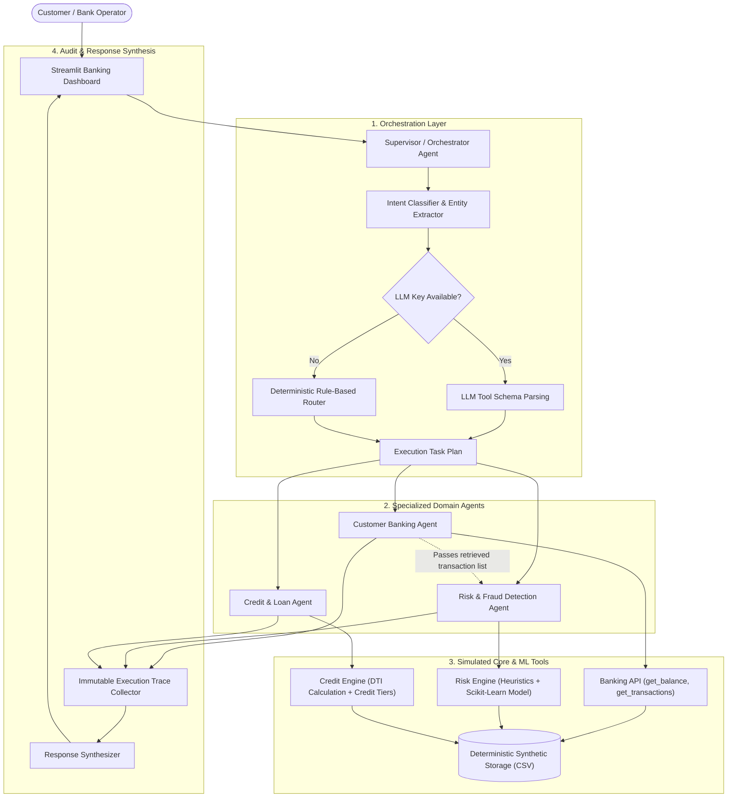

HEAD
# 🏦 BankMind AI: Multi-Agent Intelligent Banking Automation System

> **AI/ML Internship Project** • Collaborative Multi-Agent System using Experimental AI Models, Explainable Heuristics, and Scikit-Learn Anomaly Detection.

---

## 📌 1. Project Overview & Problem Statement

Modern banking platforms face dual challenges: customer service queries require natural, responsive conversations, while financial ledgers demand 100% mathematical precision and zero hallucination. Traditional chatbots either return rigid hard-coded answers or hallucinate balances and credit rules when powered by unbounded LLMs.

**BankMind AI** solves this by implementing a **Decoupled Multi-Agent Architecture**:
- A central **Supervisor / Orchestrator Agent** dynamically parses user intents and coordinates specialized domain agents.
- **Strict Data Boundaries**: Generative AI models are strictly prohibited from inventing financial figures; all facts are queried directly from deterministic simulated banking APIs.
- **Execution Transparency**: Every query generates an immutable audit trace recording detected intents, invoked agents, executed tools, and reasoning breakdowns.
- **Zero-Downtime Deterministic Fallback**: Operates 100% offline out-of-the-box without requiring paid API keys, while offering optional plug-and-play LLM support (Google Gemini / OpenAI).

---

## 🎯 2. Core Objectives

1. Demonstrate **authentic multi-agent collaboration** where distinct agents execute specialized domain logic and pass payloads to one another (e.g., Banking Agent retrieving transactions for the Risk Agent to audit).
2. Implement **explainable fraud detection** combining configurable heuristic risk scoring (0–100) with a calibrated Scikit-Learn anomaly probability.
3. Build **transparent loan underwriting** evaluating Debt-to-Income (DTI) ratios and credit tiers with itemized approval/denial reasoning.
4. Deliver a **professional Streamlit dashboard** featuring interactive Plotly visual analytics, audit logs, and demo scenario presets.

---

## 🏗️ 3. Multi-Agent Architecture



### Specialized Agent Responsibilities

| Agent Name | Module | Primary Responsibilities |
| :--- | :--- | :--- |
| **Supervisor / Orchestrator** | `agents/supervisor.py` | Dispatches natural-language requests, extracts entities, coordinates multi-agent joint workflows, records execution traces, handles unknown queries safely. |
| **Customer Banking Agent** | `agents/banking_agent.py` | Retrieves customer profile data, balances, recent transaction history, and searches specific transaction IDs. |
| **Risk & Fraud Agent** | `agents/fraud_agent.py` | Evaluates transaction amount deviations, velocity bursts, geographic mismatches, and high-risk merchant categories using heuristics and Scikit-Learn. |
| **Credit & Loan Agent** | `agents/loan_agent.py` | Calculates Debt-to-Income (DTI) ratios, assesses income and credit score criteria, calculates preliminary loan ceilings and APR estimates. |

---

## 💻 4. Technology Stack

- **Python 3.13**: Core programming runtime.
- **Streamlit**: Modern reactive web dashboard with custom fintech CSS.
- **Pandas & NumPy**: High-performance ledger filtering and moving average analysis.
- **Scikit-learn**: Random Forest anomaly classifier with calibrated probability output.
- **Plotly**: Interactive spending category donut charts and transaction timeline graphs.
- **Pytest**: Comprehensive automated test suite (37 unit tests passing).
- **Python-Dotenv**: Safe environment variable management.

---

## 📁 5. Project Directory Structure

```
bankmind-ai/
├── app.py                      # Streamlit interactive web dashboard
├── requirements.txt            # Python runtime dependencies
├── README.md                   # Complete system documentation
├── .env.example                # Safe environment configuration template
├── .gitignore                  # Prevents accidental commits of secrets/cache
│
├── data/                       # Deterministic synthetic data
│   ├── customers.csv           # Synthetic customer demographic profiles
│   └── transactions.csv        # Synthetic transactions with seeded fraud cases
│
├── agents/                     # Specialized Multi-Agent System modules
│   ├── __init__.py
│   ├── supervisor.py           # Orchestrator: routing, multi-agent flows, tracing
│   ├── banking_agent.py        # Customer account servicing agent
│   ├── fraud_agent.py          # Explainable risk scoring & ML anomaly agent
│   ├── loan_agent.py           # Underwriting & loan eligibility agent
│   └── llm_router.py           # Optional LLM API integration with rule fallback
│
├── tools/                      # Simulated Banking API Endpoints
│   ├── __init__.py
│   ├── banking_api.py          # get_customer, get_balance, assess_risk, evaluate_loan
│   └── generate_data.py        # Reproducible synthetic dataset generator
│
├── models/                     # Machine Learning Models
│   ├── __init__.py
│   ├── fraud_model.py          # Random Forest trainer & inference engine
│   └── fraud_detector.joblib   # Persisted model artifact
│
├── utils/                      # Shared System Configuration
│   ├── __init__.py
│   └── config.py               # Constants, risk thresholds, cross-platform paths
│
├── tests/                      # Automated Pytest Suite (37 tests)
│   ├── __init__.py
│   ├── test_banking.py         # 15 tests: Banking API endpoints
│   ├── test_fraud.py           # 4 tests: Heuristic and ML risk scoring
│   ├── test_loan.py            # 3 tests: Loan underwriting rules & rejections
│   ├── test_supervisor.py      # 7 tests: Single & multi-agent routing
│   └── test_llm_router.py      # 8 tests: Fallback preservation & schema mapping
│
└── docs/                       # Internship Presentation & Technical Docs
    ├── architecture.md         # Detailed architectural specification
    └── demo_video_plan.md      # 5–10 minute presentation & demo script
```

---

## 🚀 6. Installation & Execution Guide

### Prerequisites
- Python 3.10+ (Tested on Python 3.13)
- Git

### Step 1: Clone the Repository
```bash
git clone https://github.com/your-username/bankmind-ai.git
cd bankmind-ai
```

### Step 2: Create and Activate Virtual Environment (Recommended)
```bash
# Windows
python -m venv venv
venv\Scripts\activate

# macOS / Linux
python3 -m venv venv
source venv/bin/activate
```

### Step 3: Install Dependencies
```bash
pip install -r requirements.txt
```

### Step 4: Environment Configuration (Optional)
The application works **100% out-of-the-box** without any API keys via the deterministic heuristic engine. 

To optionally enable Google Gemini or OpenAI:
```bash
# Copy template
cp .env.example .env

# Edit .env and supply your key:
# GEMINI_API_KEY=your_key_here
# or
# OPENAI_API_KEY=your_key_here
```

### Step 5: Launch the Application
```bash
streamlit run app.py
```
Open your browser to: **`http://localhost:8501`**

---

## 🧪 7. Automated Testing

Run the full automated test suite using `pytest`:

```bash
pytest tests/ -v
```

**Test Coverage Summary (37 Tests Passing):**
- `test_banking.py`: Valid/invalid customer IDs, balances, transaction search, risk checks, loan underwriting.
- `test_fraud.py`: Normal vs suspicious transactions, factor explanations, batch transaction scans.
- `test_loan.py`: Loan approvals, multi-factor rejections, DTI thresholds, disclaimer verification.
- `test_supervisor.py`: All 5 core use cases, execution trace generation, multi-agent collaboration, unknown intent refusal.
- `test_llm_router.py`: LLM availability detection, zero-downtime heuristic fallback, schema mapping, data integrity.

---

## 🌟 8. Demonstration of the 5 Core Use Cases

| Use Case | Sample User Query | Executed Agents | Expected Outcome |
| :--- | :--- | :--- | :--- |
| **1. Balance Enquiry** | *"Show my account balance."* | `CustomerBankingAgent` | Returns verified balance for active persona (e.g., \$14,850.50 USD for Sarah Jenkins). |
| **2. Transaction History** | *"Show my last 5 transactions."* | `CustomerBankingAgent` | Lists 5 recent transactions sorted newest-to-oldest with merchant and amount. |
| **3. Fraud Risk Assessment** | *"Check transaction TXN1005 for suspicious activity."* | `RiskAndFraudAgent` | Analyzes \$4,850 crypto wire transfer; returns **HIGH RISK** (70/100, 100% ML prob) with factor breakdown and analyst hold recommendation. |
| **4. Loan Eligibility** | *"Am I eligible for a \$15,000 personal loan?"* | `CreditAndLoanAgent` | Evaluates income (\$7,500), debt (\$1,500), DTI (20.0%), and credit score (760); returns **Approved (Preliminary)** with max loan ceiling and estimated APR. |
| **5. Multi-Agent Collaboration** | *"Review my recent transactions and identify suspicious ones."* | `CustomerBankingAgent` + `RiskAndFraudAgent` | **Banking Agent** retrieves recent transactions; **Risk Agent** audits each record; **Supervisor** synthesizes a joint report highlighting flagged vs clean activity. |

---

## 🔒 9. Security, Reliability & Guardrails

1. **Strict Data Boundary**: Generative models cannot invent balances or credit scores; financial facts originate exclusively from `tools/banking_api.py`.
2. **Safe Fallback**: Zero runtime crash on API rate limits or missing credentials; system falls back to regex/heuristic routing seamlessly.
3. **No Unrestricted Execution**: The assistant cannot execute raw SQL or arbitrary Python code.
4. **Secret Safeguarding**: `.gitignore` strictly excludes `.env` and API keys from Git commits.
5. **Educational Disclaimer**: Every risk score and loan evaluation carries an explicit educational simulation notice.

---

## 🔮 10. Limitations & Future Roadmap

- **Simulated Core**: Uses synthetic CSV ledgers; future work could connect to ISO 20022 or Open Banking (Plaid) sandboxes.
- **Bi-directional Human-in-the-Loop**: Enable simulated customers to approve or reject flagged transactions directly via interactive SMS/Push prompt mockups.
- **RAG for Banking Policies**: Ingest PDF underwriting policy guidelines using LangChain/ChromaDB for semantic policy lookups.

---

## 📜 11. Git & GitHub Submission Guide

```bash
# 1. Initialize git (if not already initialized)
git init

# 2. Verify gitignore is active (ensure .env is NOT tracked)
git status

# 3. Add files and commit
git add .
git commit -m "feat: complete BankMind AI multi-agent banking system MVP"

# 4. Push to your GitHub repository
git remote add origin https://github.com/<your-username>/bankmind-ai.git
git branch -M main
git push -u origin main
```

# BankMind-AI
 8d5f94992aa12e03d0a3a85868d0e1c436c28984
