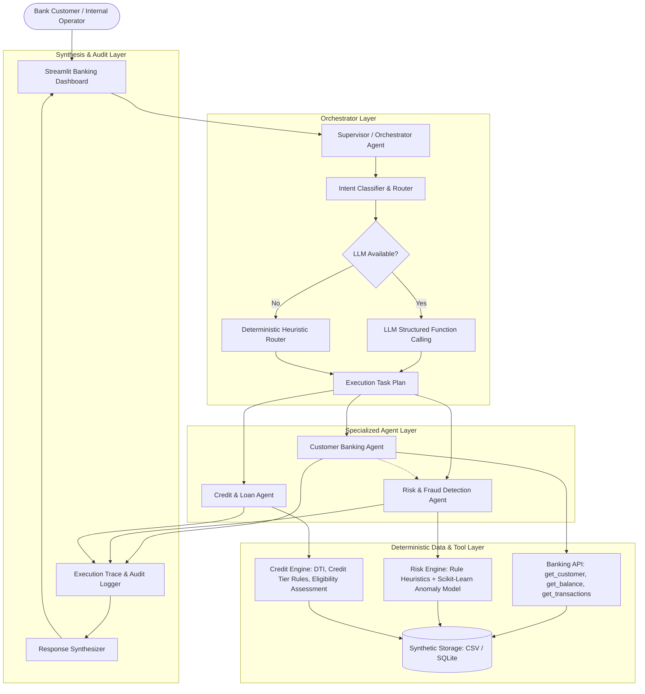

# BankMind AI: Multi-Agent Intelligent Banking Automation System
## Architectural Specification & Design Document

### 1. Executive Summary
**BankMind AI** is an enterprise-grade banking automation prototype designed for academic and internship demonstrations. It implements a decoupled, transparent Multi-Agent System (MAS) wherein a central **Supervisor/Orchestrator Agent** dynamically routes user intents to specialized domain agents:
1. **Customer Banking Agent**: Account queries, balances, transaction logs.
2. **Risk and Fraud Detection Agent**: Rule-based heuristics + calibrated ML anomaly detection with transparent factor attribution.
3. **Credit and Loan Agent**: Deterministic underwriting assessment, debt-to-income (DTI) calculations, and preliminary loan eligibility screening.

All agent interactions maintain an immutable **Execution Trace**, recording every intent classification, agent selection, tool invocation, raw tool payload, and reasoning step.

---

### 2. Multi-Agent System Architecture



---

### 3. Core Architectural Principles & Security Boundaries

1. **Strict Data Boundary (No AI Hallucination Policy)**:
   - The LLM is **strictly prohibited** from fabricating financial figures, customer names, balances, credit scores, or transaction histories.
   - All factual data is retrieved exclusively through deterministic Python API endpoints (`tools/banking_api.py`).
   - The LLM or rule-based synthesizer only contextualizes verified tool outputs into conversational summaries.

2. **Dual-Path Routing (Zero-Downtime Fallback)**:
   - When an LLM API key (`GEMINI_API_KEY` or `OPENAI_API_KEY`) is active, intent classification and response synthesis use natural-language comprehension.
   - If no API key is provided, the network is offline, or rate limits occur, the **Deterministic Heuristic Engine** activates automatically. The application remains 100% operational for evaluation without requiring paid cloud services.

3. **Multi-Agent Execution Transparency**:
   - Every user prompt generates a structured trace object:
     ```json
     {
       "query": "Show my recent transactions and identify suspicious ones.",
       "detected_intent": "multi_agent_review",
       "agents_invoked": ["CustomerBankingAgent", "RiskAndFraudAgent"],
       "tools_executed": ["get_recent_transactions", "assess_transaction_risk"],
       "tool_results": [...],
       "risk_reasoning": [...],
       "final_response": "..."
     }
     ```
   - In the Streamlit UI, this trace is rendered in an interactive audit expander so reviewers can verify real multi-agent collaboration.

---

### 4. Technology Stack & Justification

| Layer | Technology | Rationale & Trade-offs |
| :--- | :--- | :--- |
| **User Interface** | Streamlit | Rapid reactive UI, zero JavaScript build chain, native support for data tables, metrics cards, and reactive state. |
| **Data Processing** | Pandas + NumPy | High-performance vectorized operations on transaction ledgers; seamless conversion to structured dicts and tables. |
| **Machine Learning** | Scikit-learn (IsolationForest / LogisticRegression) | Transparent feature importance and anomaly scoring on synthetic fraud datasets. |
| **Data Visualization**| Plotly | Interactive zoomable transaction timelines, balance charts, and risk factor distributions. |
| **Storage** | Synthetic CSV / SQLite | Deterministic, version-controllable, zero-credential local persistence. |
| **Agent Framework** | Native Modular Python | Avoids bloated, rapidly-breaking orchestration frameworks. Direct, transparent control flow with 100% reproducible execution traces. |

---

### 5. Specialized Agent Specifications

#### A. Supervisor / Orchestrator Agent (`agents/supervisor.py`)
- Analyzes incoming natural-language queries.
- Dispatches execution tasks sequentially or concurrently to specialized agents.
- Handles multi-intent requests (e.g., retrieving transactions AND scanning each for fraud).
- Synthesizes findings into human-readable banking explanations.

#### B. Customer Banking Agent (`agents/banking_agent.py`)
- Interfaces with synthetic banking core.
- Executes:
  - `get_customer(customer_id)`
  - `get_account_balance(customer_id)`
  - `get_recent_transactions(customer_id, limit)`
  - `get_transaction(transaction_id)`

#### C. Risk & Fraud Detection Agent (`agents/fraud_agent.py`)
- Evaluates risk along 4 distinct heuristic axes:
  1. Transaction Amount relative to customer 30-day moving average.
  2. Transaction Frequency (burst velocity within 1 hour).
  3. Location Deviation (foreign or mismatched geography).
  4. High-risk Merchant Category (cryptocurrency, wire transfer, luxury jewellery).
- Hybrid ML scoring: Scikit-learn model calculates anomaly probability.
- Formulates risk rating (`LOW`, `MEDIUM`, `HIGH`) and explicit factor breakdown.

#### D. Credit & Loan Agent (`agents/loan_agent.py`)
- Underwrites loan requests against simulated customer metrics:
  - Monthly income threshold ($3,000 min).
  - Debt-to-Income (DTI) ratio (<= 45%).
  - Credit Score classification (Excellent >= 750, Good >= 700, Fair >= 650, Poor < 650).
- Produces maximum eligible loan offer, interest rate estimate, and clear simulation disclaimers.
